# CareSync 🩺
### AI-Powered Family Health Management & Clinical Communication Portal

[](https://caresync-ai-three.vercel.app)
[](https://github.com/Jayashree-ku/Care-sync)
[](https://github.com/Jayashree-ku/Care-sync)
[]()
[]()
[](LICENSE)

> **CareSync** empowers patients and family caregivers to organize symptoms, medical histories, and medications into clear, structured, and clinically actionable summaries that can be shared directly with doctors during high-stress consultations.

---

## 🔗 Quick Links

- 🌐 **Live Web Application**: [https://caresync-ai-three.vercel.app](https://caresync-ai-three.vercel.app)
- 📂 **GitHub Repository**: [https://github.com/Jayashree-ku/Care-sync](https://github.com/Jayashree-ku/Care-sync)
- 🧪 **Automated Test Suite**: Included locally via `npm test`

---

## 📸 Cross-Platform Experience: Web (Desktop) & Android (Mobile)

CareSync is engineered with a **responsive, touch-optimized clinical design system** that adapts seamlessly from desktop consultation prep to handheld mobile presentation in the clinic.

### 1. Family Health Dashboard
*Comprehensive health overview showing active profile, vital counts, quick clinical actions, and instant family switching.*

| Desktop Web View (1440×900) | Android Mobile View (Pixel 7 • 412×915) |
| :---: | :---: |
| 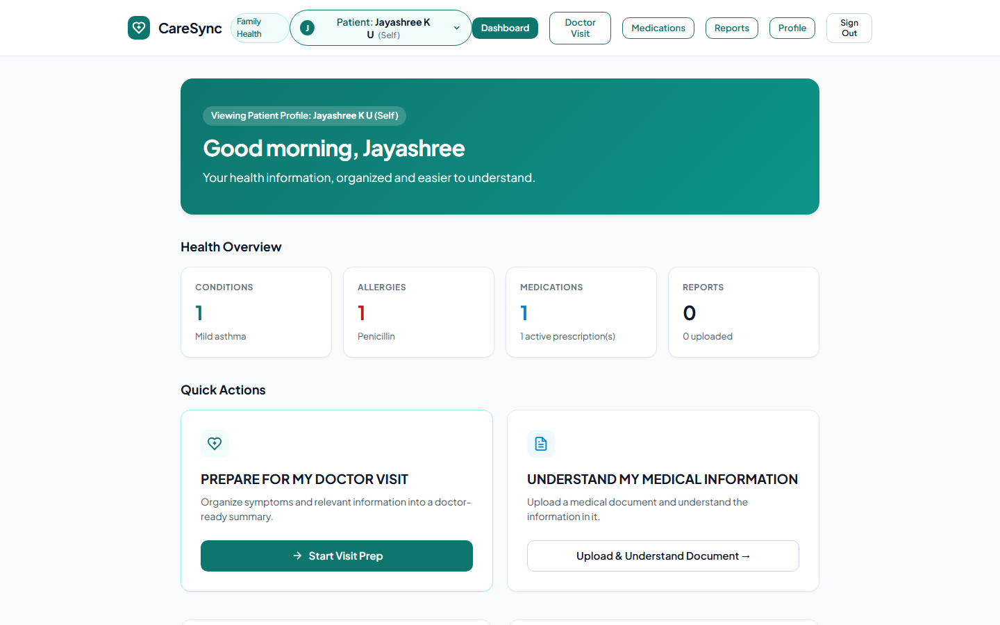 | 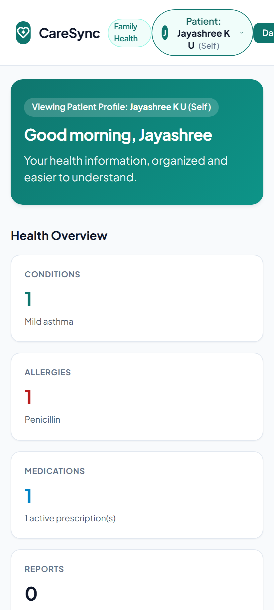 |

---

### 2. Prepare for My Doctor Visit (Guided Intake Flow)
*12-step structured questionnaire with progress tracking, non-intimidating input chips, and progressive disclosure.*

| Desktop Web View (1440×900) | Android Mobile View (Pixel 7 • 412×915) |
| :---: | :---: |
| 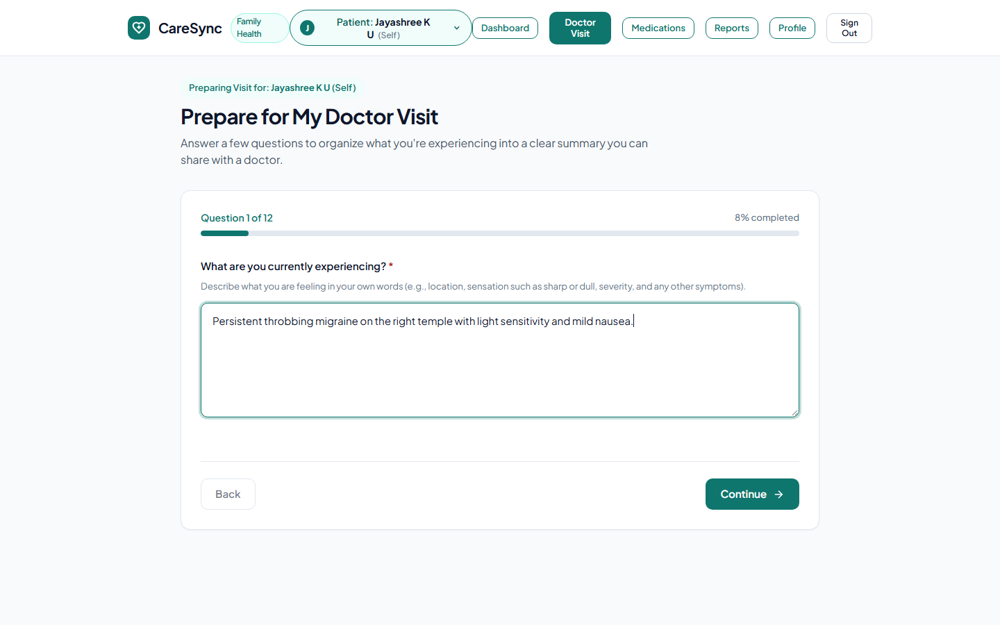 | 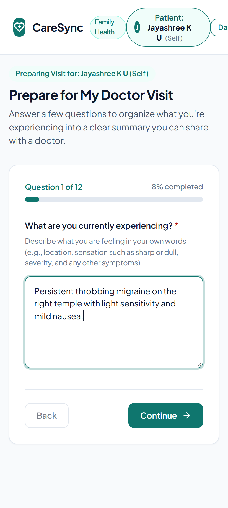 |

---

### 3. Structured Doctor Visit Summary
*Patient-reported synthesis with timeline categorization, prior history, urgency assessment, and action controls.*

| Desktop Web View (1440×900) | Android Mobile View (Pixel 7 • 412×915) |
| :---: | :---: |
| 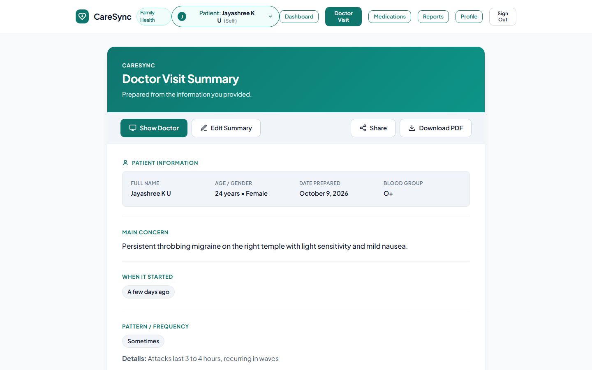 | 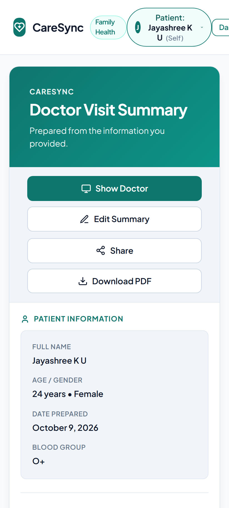 |

---

### 4. Clinical Presentation ("Show Doctor") Mode
*High-contrast, distraction-free view with large typography and allergy alert borders, designed specifically for holding across an examination desk.*

| Desktop Web View (1440×900) | Android Mobile View (Pixel 7 • 412×915) |
| :---: | :---: |
| 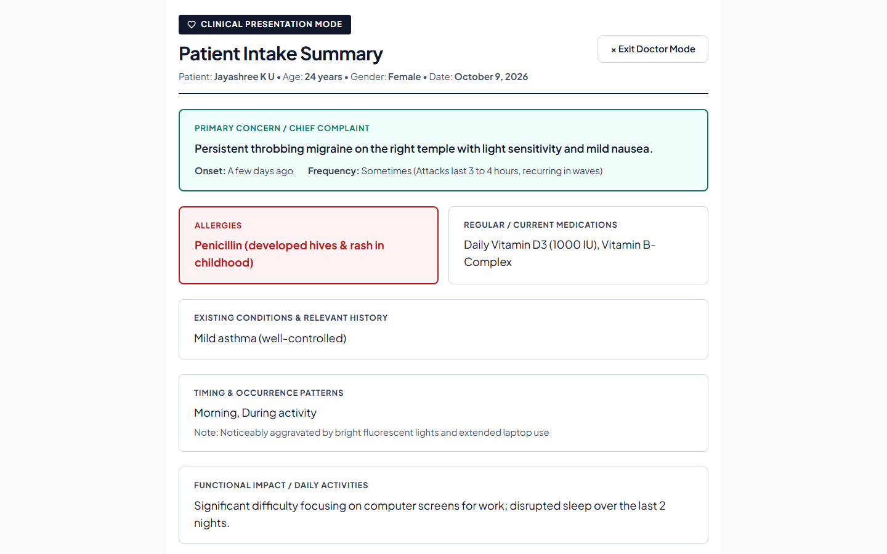 | 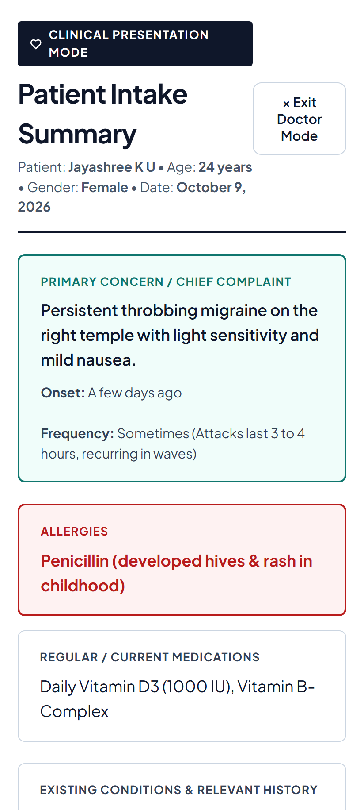 |

---

### 5. Multi-Patient Family Management
*Manage individual health profiles, chronic conditions, emergency contacts, and active prescriptions for every family member.*

| Desktop Web View (1440×900) | Android Mobile View (Pixel 7 • 412×915) |
| :---: | :---: |
| 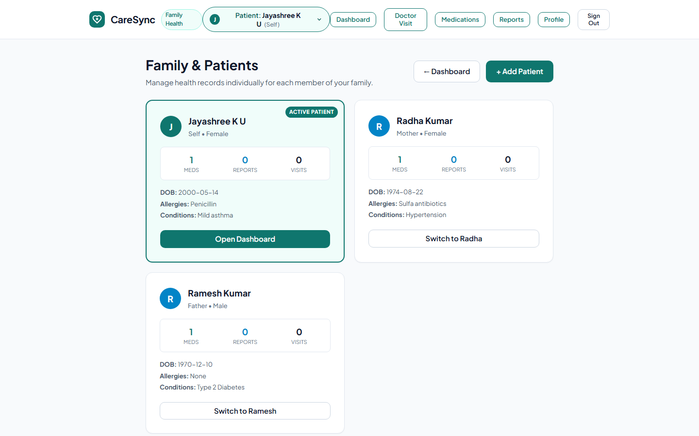 | 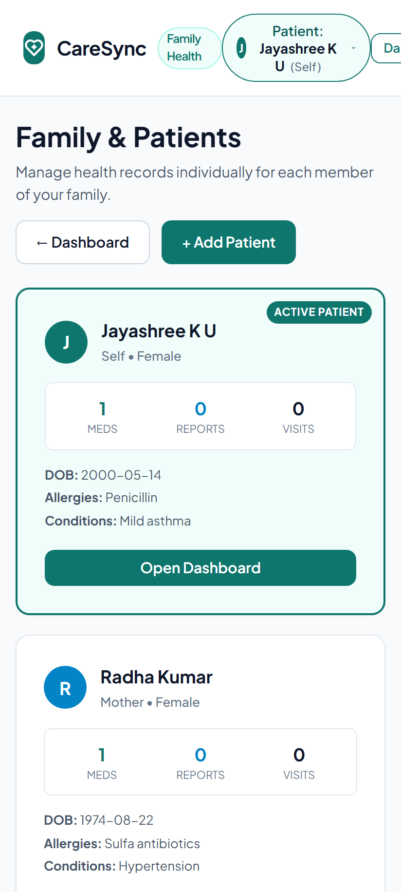 |

---

## 🎯 The Core Problem

1. **The 15-Minute Doctor Consultation Dilemma**:
   - Patients forget **40% to 80%** of medical details under high-stress consultation environments.
   - Crucial timeline details (when pain began, what aggravated it, over-the-counter medications taken) are frequently omitted, risking misdiagnosis or delayed care.

2. **The Family Caregiver Burden**:
   - Family members often manage healthcare for elderly parents, children, and themselves simultaneously.
   - Medical information is scattered across notes, prescription bottles, and chat messages with no patient-level isolation.

---

## 💡 What CareSync Delivers

### 1. 👨‍👩‍👧‍👦 Multi-Patient Family Architecture
- **Complete Patient Isolation**: Each family member (e.g., *Self*, *Mother*, *Father*, *Grandmother*, *Child*) possesses dedicated doctor visit histories, active medications, uploaded documents, and emergency contacts.
- **Global Patient Switcher**: Seamless 1-click patient switching from the navigation bar without losing context.
- **Dedicated Family Directory**: Create and edit family member profiles with relationship tags and blood group details.

### 2. 🩺 "Prepare for My Doctor Visit" (12-Step Guided Intake)
A 12-question intake questionnaire designed according to clinical communication best practices:
1. **Chief Complaint / Symptoms**: Unconstrained descriptive symptom intake.
2. **Onset & Timeline**: Specific onset selection (*Today*, *A few days ago*, *A few weeks ago*, *More than a month ago*, *I'm not sure*).
3. **Pattern & Frequency**: Frequency patterns (*Constantly*, *Sometimes*, *At specific times*, etc.) with optional descriptive details.
4. **Circumstances & Timing**: Multi-factor selection (*Morning*, *Night*, *After eating*, *During activity*, *Resting*).
5. **Functional Daily Impact**: Impact on sleep, work, eating, and mobility.
6. **Prior Occurrences**: Progressive disclosure collecting past occurrence history if applicable.
7. **Interventions Taken**: Log over-the-counter or prescribed treatments, timing, and reported effectiveness.
8. **Regular Medications**: Current chronic maintenance drugs or supplements.
9. **Existing Medical Conditions**: Past medical history relevant to current symptoms.
10. **Known Allergies**: High-priority alert mapping for drug, food, and environmental allergies.
11. **Document Attachment**: Optional document upload UI for lab results or prior prescriptions.
12. **Questions for the Physician**: Open space to organize prioritized questions for the doctor.

### 3. 📋 Pure Structured Clinical Summary Synthesis
- **Zero AI Hallucination Risk**: Synthesized purely client-side using deterministic clinical formatting rules.
- **Integrity of Missing Data**: Accurately records statements like *"I'm not sure"*, *"None reported"*, and *"Not specified"* without fabricating details.
- **Urgency Indicator**: Visual clinical urgency triage based on symptom duration and functional impact.

### 4. 📱 "Show Doctor" In-Clinic Presentation Mode
- Distraction-free, full-screen clinical card mode.
- High-contrast typography optimized for rapid review by physicians across an examination desk in 30 seconds.
- High-visibility red alert borders for drug allergies and active medications.

### 5. 📄 Multi-Page Clinical PDF Export Engine
- Native PDF generation built with `jsPDF`.
- Multi-page page budgeting, clean margins, headers, page numbers, emergency contacts, and medical disclaimers.
- Ready for printing or uploading into hospital electronic health record (EHR) portals.

---

## 🛡️ Clinical Safety & Ethics

CareSync adheres to strict healthcare ethics:
- **Zero Medical Advice / Non-Diagnostic**: CareSync never diagnoses medical conditions, suggests medication dosages, or prescribes treatments.
- **Patient Autonomy & Privacy**: All session data remains client-controlled in browser storage; zero third-party tracking or healthcare data harvesting.
- **WCAG AA Compliance**: High-contrast, accessible color palette (slate, teal, emerald, alert crimson) strictly avoiding low-contrast purple hues or extraneous decorative emojis.

---

## 🏗️ System Architecture

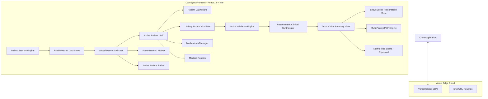

---

## 💻 Tech Stack

| Layer | Technology | Description |
| :--- | :--- | :--- |
| **Frontend Framework** | React 18 (`react`, `react-dom`) | Modern component-driven reactive architecture |
| **Build Tool** | Vite 5 | High-speed ESM bundling and optimized production builds |
| **Document Engine** | jsPDF 4.2.1 | Client-side multi-page PDF generation |
| **Design System** | Custom Clinical CSS & Design Tokens | Slate & teal accessible medical aesthetic (WCAG AA) |
| **Testing & Verification** | Node.js Test Runner & Puppeteer Core | Headless browser flow verification & screenshot automation |
| **Deployment & Hosting** | Vercel | Global edge CDN deployment with SPA routing rewrites |

---

## 🚀 Getting Started & Local Setup

### Prerequisites
- Node.js (v18.0.0 or later)
- npm (v9.0.0 or later)

### Installation

```bash
# 1. Clone the repository
git clone https://github.com/Jayashree-ku/Care-sync.git

# 2. Navigate to the project directory
cd Care-sync

# 3. Install dependencies
npm install

# 4. Start local development server
npm run dev
```

Visit `http://localhost:5175` in your browser.

### Run Automated Tests

To run the end-to-end family health data isolation and questionnaire test suite:

```bash
npm test
```

### Build for Production

```bash
npm run build
```

---

## 🧑‍⚖️ Hackathon Evaluation Guide (2-Minute Test Drive)

For judges and evaluators reviewing the live application at **[https://caresync-ai-three.vercel.app](https://caresync-ai-three.vercel.app)**:

1. **Test Patient Switching**:
   - On the top navigation bar, click the **Patient** dropdown.
   - Switch between **Jayashree (Self)**, **Radha Kumar (Mother)**, and **Ramesh Kumar (Father)**.
   - Observe how the dashboard, conditions, and medications adapt to that specific family member.
2. **Complete Doctor Visit Intake**:
   - Click **"Prepare for My Doctor Visit"** or click **"Start Visit Prep"**.
   - Fill in symptoms (*e.g., "Persistent throbbing migraine with light sensitivity"*).
   - Advance through the 12 questions using the intuitive chips and selectors.
   - Review your answers on the Review screen and click **"Generate Doctor Visit Summary"**.
3. **Experience "Show Doctor" Mode**:
   - On the Summary page, click the teal **"Show Doctor"** button.
   - Experience the high-contrast presentation card with allergy safety warnings.
   - Click **"Exit Doctor Mode"** to return.
4. **Generate Clinical PDF**:
   - Click **"Download PDF"** on the summary view to inspect the multi-page clinical document export.

---

## 📄 License

This project is licensed under the [MIT License](LICENSE) - see the LICENSE file for details.

---

*CareSync summaries are generated from patient-reported information to facilitate clear, structured communication between patients and healthcare professionals. CareSync is not a diagnostic tool and does not provide medical advice or prescriptions.*
